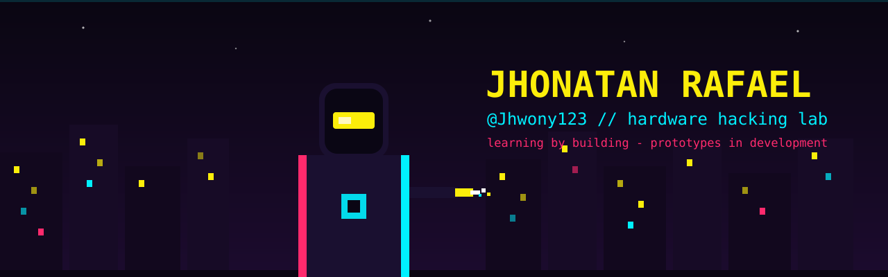
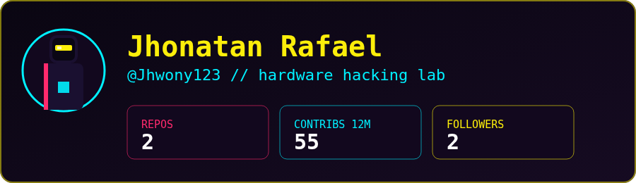

<!-- BANNER -->

  

<!-- HEADER ANIMADO ESTILO TERMINAL -->

  

<!-- CARTAO DE PERFIL (metricas verificadas na conta: repos publicos, contribuicoes 12 meses, seguidores) -->

  

## `> whoami`

Estou aprendendo a construir: eletronica, hardware hacking e web. Este perfil
documenta meus prototipos e o que vou descobrindo no caminho.

## `> projeto em destaque`

### 🛰️ AETHER Lab (privado, em desenvolvimento)

Prototipo de laboratorio interativo simulado de hardware hacking: minicurso
gamificado com missoes de boot/terminal, multimetro, solda e firmware. As
missoes rodam em simulacao no navegador; o objetivo e aprender a construir a
experiencia. Feito com React, TypeScript e Vite.

## `> habilidades em treino`

  
  
  
  
  

  <code>[+] PROTOTIPO EM DESENVOLVIMENTO. SIMULACAO, NAO HARDWARE REAL.</code>

