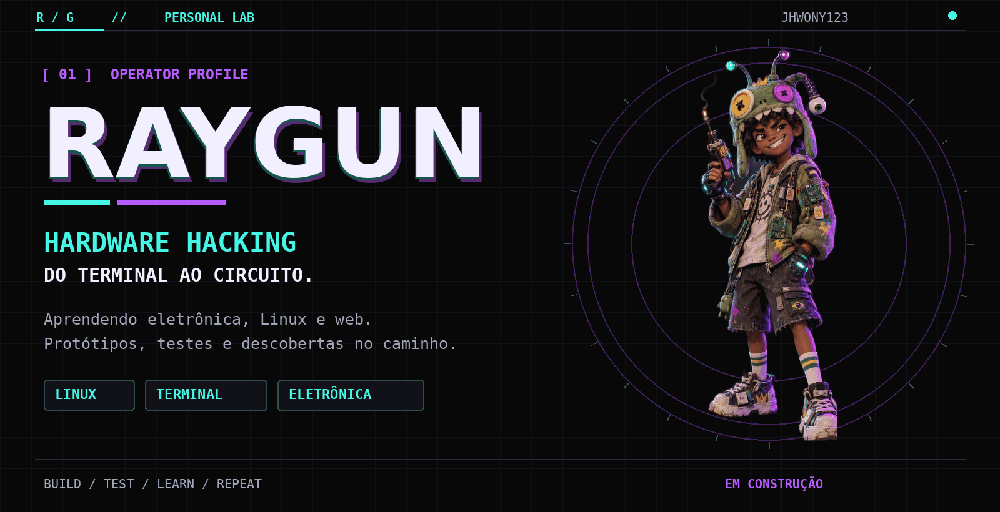
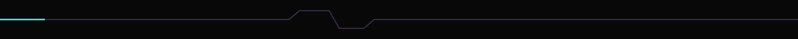
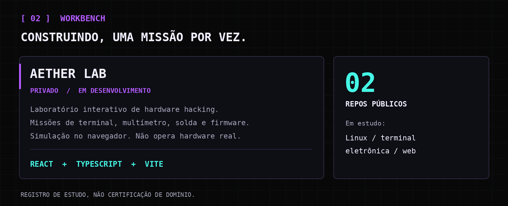

  
  
  

### Projetos públicos

[**app-de-marketing**](https://github.com/Jhwony123/app-de-marketing) · TypeScript  
[**Este perfil**](https://github.com/Jhwony123/Jhwony123) · Identidade visual Raygun

### Cidade de contribuições

<picture>
  <source media="(prefers-color-scheme: dark)" srcset="https://ssr-contributions-svg.vercel.app/_/Jhwony123?chart=3dbar&gap=0.6&scale=2&flatten=0&animation=wave&animation_duration=4&format=svg&weeks=26&theme=purple&dark=true">
  
</picture>

Aprendizado em andamento. AETHER Lab é um protótipo simulado, não opera hardware real. Painel de repositórios atualizado em 24/11/2026. Cidade gerada a partir das contribuições públicas, sujeita à disponibilidade do serviço.
