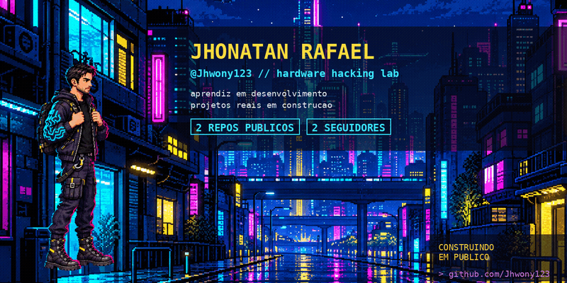

<!-- BANNER CYBERPUNK PIXEL ART -->

  

<h2 align="center"><code>[+] RAYGUN // HARDWARE HACKING LAB</code></h2>

<code>LEARN. BUILD. BREAK. REPEAT.</code>

<table>
<tr>
<td valign="top">

<h3><code>~ $ whoami</code></h3>

<pre>
raygun: aprendendo a construir: eletrônica,
hardware hacking e web. Este perfil documenta
meus protótipos e o que vou descobrindo no caminho.

no momento: mapa de diretórios do Linux
(/bin, /etc, /home, /var...) e comandos de terminal,
aplicados nas missões do laboratório.
</pre>

<h3><code>~ $ cat linguagens-dos-repos.txt</code></h3>

<pre>
typescript  ████████████████████  90%
scss        ██                     9%
</pre>

Em estudo:

  
  
  
  
  
  
  

<h3><code>~ $ stats</code></h3>

<pre>
repositories   2 public
stars          0
followers      2
contributions  26 (last 12 months)
</pre>

</td>
<td width="330" valign="middle" align="center">
  
</td>
</tr>
</table>

### `~ $ ls projects --sort=stars`

<table>
<thead><tr><th align="left">Project</th><th align="left">About</th><th align="right">★</th></tr></thead>
<tbody>
<tr><td align="left">🛰️ <b>AETHER Lab</b> <code>privado</code></td><td align="left">Protótipo de laboratório interativo simulado de hardware hacking: minicurso gamificado com missões de boot/terminal, multímetro, solda e firmware. React, TypeScript e Vite.</td><td align="right">🔒</td></tr>
<tr><td align="left"><a href="https://github.com/Jhwony123/app-de-marketing">app-de-marketing</a></td><td align="left">App de marketing em TypeScript.</td><td align="right">0</td></tr>
<tr><td align="left"><a href="https://github.com/Jhwony123/Jhwony123">Jhwony123</a></td><td align="left">Este perfil.</td><td align="right">0</td></tr>
</tbody>
</table>

### `~ $ ./cidade-de-contribuicoes`

<picture>
  <source media="(prefers-color-scheme: dark)" srcset="https://ssr-contributions-svg.vercel.app/_/Jhwony123?chart=3dbar&gap=0.6&scale=2&flatten=0&animation=wave&animation_duration=4&format=svg&weeks=26&theme=purple&dark=true">
  
</picture>

contribuições públicas no GitHub · últimas 26 semanas · atualiza automaticamente

### `~ $ contact`

<a href="https://github.com/Jhwony123">GitHub</a>

  <code>[+] PROTOTIPO EM DESENVOLVIMENTO. SIMULACAO, NAO HARDWARE REAL.</code>

Base: Plain Terminal · personalizado com Raygun · made with <a href="https://www.gitskins.com/readme-generator">GitSkins</a>
