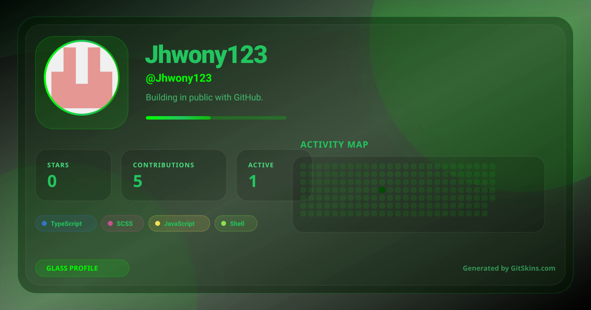
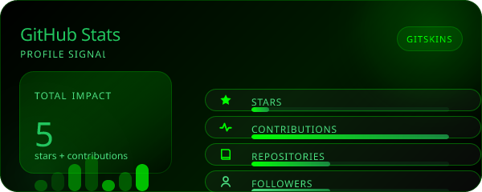
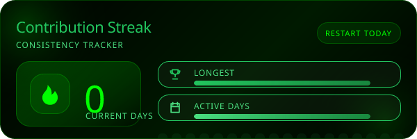
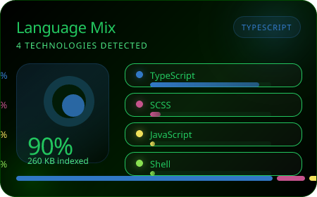

<!-- HEADER ANIMADO ESTILO TERMINAL -->

  

<!-- CARTAO DE PERFIL (gerado com GitSkins, dados reais) -->

  

## `> whoami`

Garcom de dia, construtor de noite. Estou migrando para tecnologia montando
projetos reais: eletronica, hardware hacking e web. Cada missao que eu completo
no laboratorio vira algo que eu sei fazer com as maos, nao so na teoria.

## `> projeto em destaque`

### 🛰️ AETHER Lab (privado)

Laboratorio interativo de hardware hacking: minicurso gamificado com missoes
praticas (boot/terminal, multimetro, solda, firmware) e um projeto final de
desbloqueio de drone. Feito com React, TypeScript e Vite.

## `> habilidades em treino`

  
  
  
  
  

<!-- METRICAS REAIS (GitSkins, atualizacao automatica) -->

  
  

  

  <code>[+] BUILD EM ANDAMENTO... NADA AQUI E PROMESSA, TUDO E PRATICA.</code>

